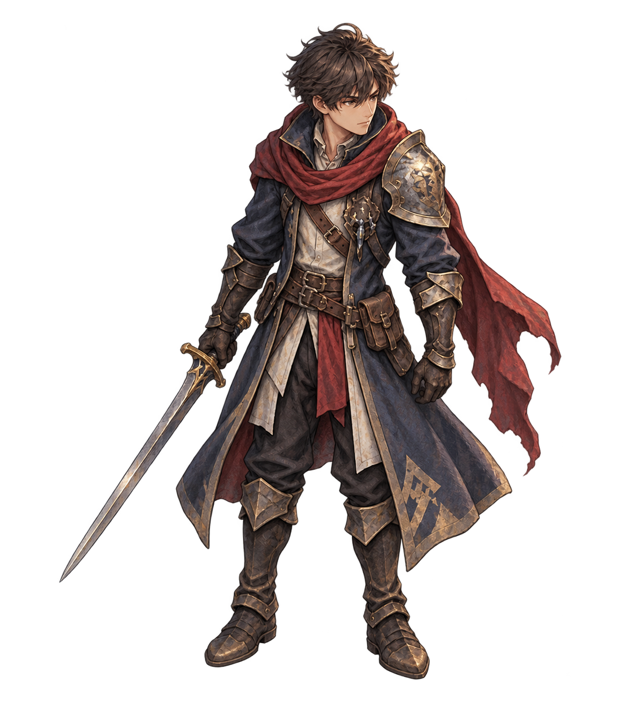
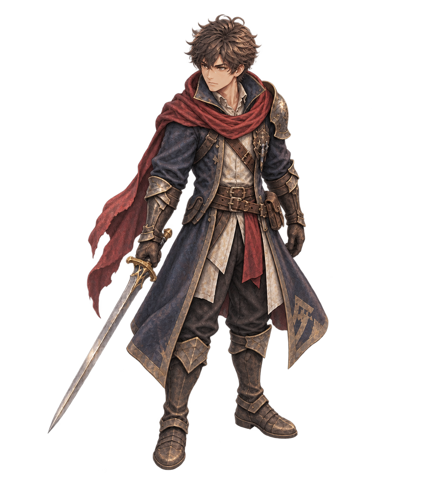
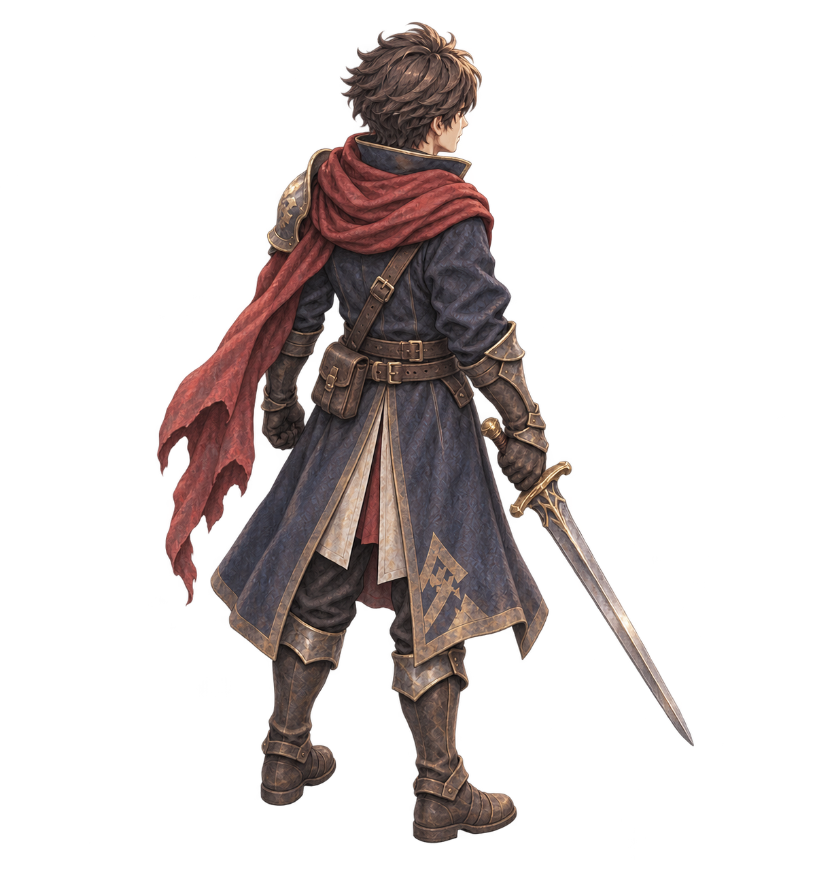
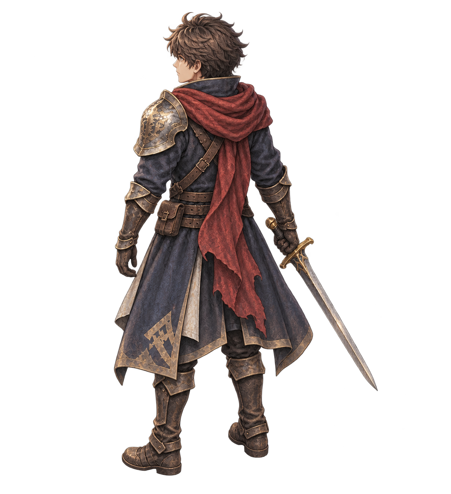

# Kael directional idle candidates

**Source-only review asset. Not accepted, integrated, merged, or deployed.**

Four new, individually generated painterly idle views for the swordsman identity used by Kael in the isolated 2v2 prototype. These are not animation frames or a final anatomical turnaround. The prototype reference is preserved in navy, ivory and red, with a sword in the anatomical right hand and an ornate pauldron on the anatomical left shoulder. No view was produced by mirroring another.

## Images

SE and SW are front three-quarter candidates. NE and NW are rear three-quarter candidates.





## Files and use

- `images/`: four unchanged 1199 × 1312 RGBA generated sources, ordinary PNG blobs rather than LFS pointers.
- `manifest.json`: hashes, foot pivots, head/body scale, centered Sprite2D offsets, equipment contract and limitations.
- `prompts/`: exact built-in image generation prompts, one image per call.
- `project.godot`, `Review.tscn`, `Review.gd`: standalone 86 / 172 / 344 px body-height review over a 128 × 64 tile marker. It does not load or change the game.
- `qa/`: repeatable Python source checks, Godot PNG/import/texture/pivot tests and completed results.

For an unmirrored centered `Sprite2D`, load a source texture, set `offset` to its `centered_sprite_offset_px`, and set uniform scale to `display_scale`. The node origin is the calibrated foot pivot. This displays head to projected boot midpoint at 86 px. Do not recenter by image bounds: the sword extends far outside the body. The source pivots are manual review calibrations, not accepted production anchors.

| View | Foot pivot | Scale for 86 px body | Centered offset |
| --- | --- | --- | --- |
| SE | 590, 1248 | 0.0713101161 | 9.5, -592 |
| SW | 601, 1223 | 0.0725738397 | -1.5, -567 |
| NE | 545, 1200 | 0.0736301370 | 54.5, -544 |
| NW | 538, 1229 | 0.0717863105 | 61.5, -573 |

The metadata is authoritative; the rounded table is explanatory.

## Verification completed

- 50 Python asset contract checks passed: source SHA-256, RGBA, dimensions, transparency, equipment declarations, no mirroring and pivot/scale math.
- Godot 4.6.3 standalone import passed, followed by 30 source decode, imported Texture2D, pivot and review-script/scene checks.
- Standalone review scene completed a three-frame headless smoke run with no script errors.
- Full-resolution visual inspection found the right-hand sword and left pauldron retained across all four views.
- Source PNGs have 69.7–73.8% fully transparent pixels; the visible silhouettes have clear margins. Original alpha is preserved.

## Remaining gates

- **No native graphical or in-game acceptance is claimed.** A local dummy-display launch could not establish its sockets, including one permitted retry. The source image inspection and headless checks are not a rendered 86 px review.
- **Embroidery, belt details, scarf drape and coat proportions still drift.** In particular, NE coat embroidery does not consistently remain on the same anatomical panel as the front views. Fix or approve these differences before treating the set as canon.
- The front views are relatively frontal; confirm camera angle and silhouette beside Zane in the courtyard.
- Sparse alpha=1 source specks touch image borders. No invisible-edge cleanup or opaque-body restoration was silently applied.
- No walk, attack, cast, hurt, defeat or matching portrait animation was created in this batch.
- This source-only change does not replace compact sprites, register new runtime paths, alter combat or deploy the demo. Full gameplay regression was not run for this isolated asset pack.

## Reproduce

From this directory, with Python 3 + Pillow and Godot 4.6.3 installed:

```sh
python qa/validate_assets.py
godot --headless --editor --path . --import --quit
godot --headless --path . --script res://qa/validate_godot.gd
godot --headless --path . --quit-after 3
# Graphical review when a display is available:
godot --path .
# Optional actual viewport capture:
godot --path . -- --capture
```

`qa/build_manifest.py` updates metadata from the unchanged source PNGs and the explicit manually chosen pivots. It does not edit images.

## Provenance

The current Kael swordsman mapping was inspected in prototype commit `8d66158`, whose `Unit.gd` selects the `compact/frames/swordsman` set for `kael`. This candidate uses the corresponding painterly source as its identity guide, rather than older Vanguard or Warden art with conflicting character mappings:

- [Prototype Unit mapping](https://github.com/Rando2020/ProjectTactic/blob/8d66158/demos/isometric-2v2/prototypes/isometric/Unit.gd)
- [Painterly swordsman reference](https://github.com/Rando2020/ProjectTactic/blob/8d66158/demos/isometric-2v2/prototypes/isometric/assets/character-sets/painterly/originals/swordsman.png), SHA-256 `73eed48abb76e434f80197dfc34f76cddb8c15d565b8f9455f932ce36d3d36a1`.
- Generated on 2026-11-09 with OpenAI built-in image generation. SE uses the reference sheet; SW/NE/NW each use the new SE source as the identity guide.

The generated images are candidates, not evidence that a final Kael appearance has been approved.
