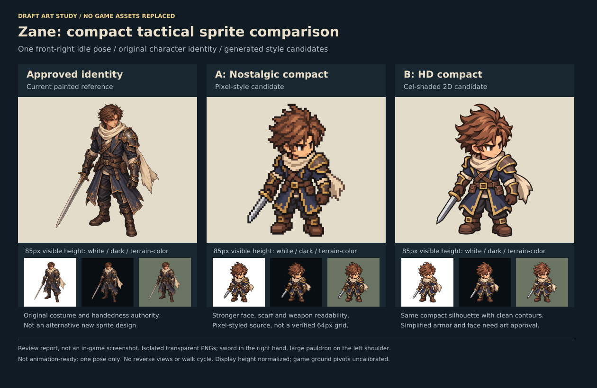

# Zane compact sprite style study

**Draft, source-only art study. Not approved gameplay art. No runtime assets or manifests changed.**

This is a deliberately small test of two visual treatments for the same existing Zane character: a nostalgic compact pixel-style sprite and a compact HD cel-shaded 2D sprite. Both are one isolated front-right idle pose, not a concept collage, full direction set, animation, rig, or 3D model.

## Files

- `images/zane-approved-reference.png`: byte-identical copy of the approved Zane reference already in the repository.
- `images/zane-pixel-compact-candidate.png`: new 1086 x 1448 transparent pixel-style candidate.
- `images/zane-hd-compact-candidate.png`: new 1086 x 1448 transparent HD candidate.
- `review.html`: offline comparison with both candidates and the original, enlarged and at 85 px visible height on light, dark, and terrain-color backgrounds.
- `evidence/style-comparison.png` and `evidence/Zane-Sprite-Comparison.pdf`: rendered comparison report. **Not an in-game or browser screenshot.**
- `manifest.json`: exact PNG hashes, real dimensions and measured alpha bounds. Review normalization is not a calibrated gameplay pivot.
- `prompts.json`: exact generation prompts, including superseded exploratory iterations.
- `qa.md`: visual findings, limits, provenance and next acceptance gate.
- `validate.py`: read-only artifact and scope checks. Run `python validate.py` here; requires Pillow.

## Actual workflow used

Image creation used the built-in ImageGen tool, with the approved Zane PNG as identity reference. No paid third-party generation provider was selected, no external sprite-maker software was installed or executed, and no 3D render/animation pipeline is claimed.

The following published skill guidance was consulted and applied to the scope that actually ran:

- [sprite-gen v4.3.0](https://github.com/aldegad/sprite-gen/blob/main/SKILL.md): base/directional anchor and asymmetric accessory checks from its [directional workflow](https://github.com/aldegad/sprite-gen/blob/main/docs/directional-anchor-workflow.md).
- [Codex to 2D Sprites](https://github.com/zhangrlll/codex-to-2d-sprites/blob/main/skills/codex-to-2d-sprites/SKILL.md): original identity, small-batch ImageGen and [visual QA](https://github.com/zhangrlll/codex-to-2d-sprites/blob/main/skills/codex-to-2d-sprites/references/visual-qa.md) guidance. Its rig/Blender, multi-direction, motion and engine-interaction stages did **not** run.

First tall treatments were rejected for insufficiently compact proportions. The user's small before/after genre reference then guided a shorter silhouette. The selected pixel candidate became the proportion reference for the selected HD candidate. The commercial reference is not included in this pack or the repository. No game sprite pixels or franchise costumes were copied into these files.

These candidates preserve Zane's brown hair, cream scarf, navy coat, brown leather, right-hand sword and large anatomical-left pauldron. The intentional simplification of face, coat length and ornament still needs art acceptance.

## Before promotion

Choose a style and settle the face/proportion and armor-detail tradeoffs. Then generate actual opposite/rear anchor views with fixed anatomical handedness and calibrated boot contacts, before producing a short alternating-foot loop. A one-frame PNG cannot prove motion continuity. Existing approved art and gameplay remain authoritative.
