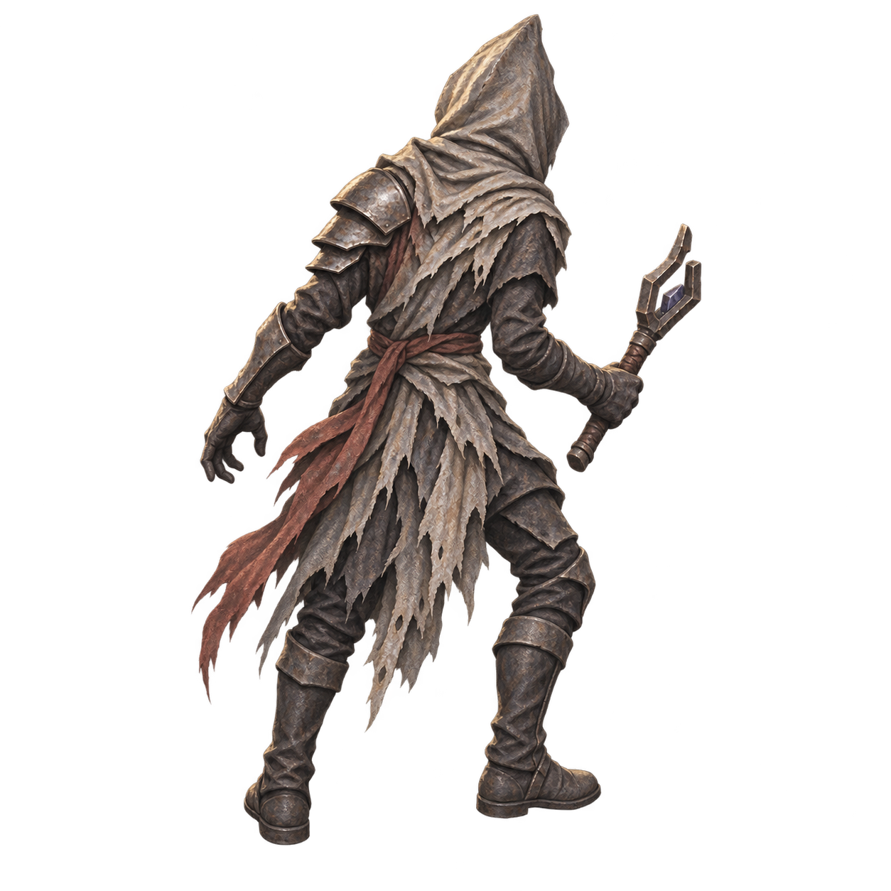
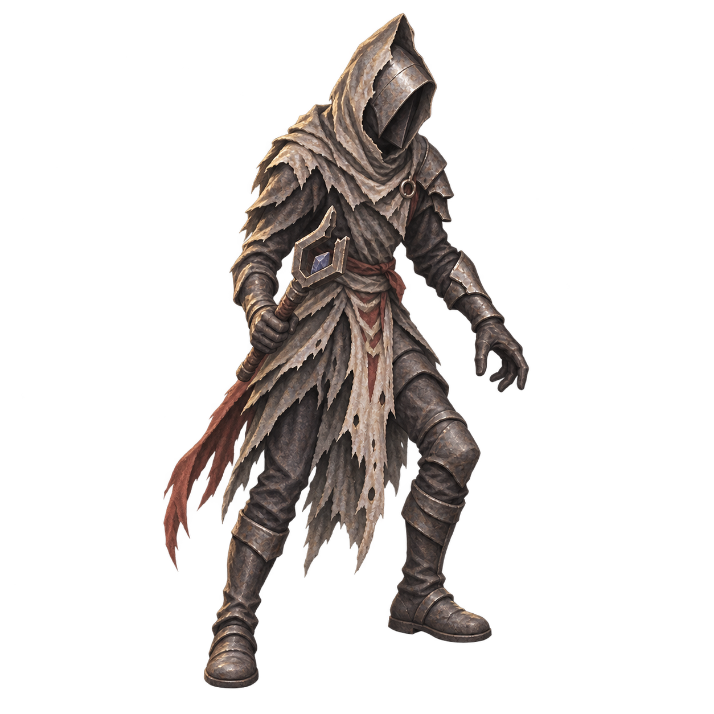
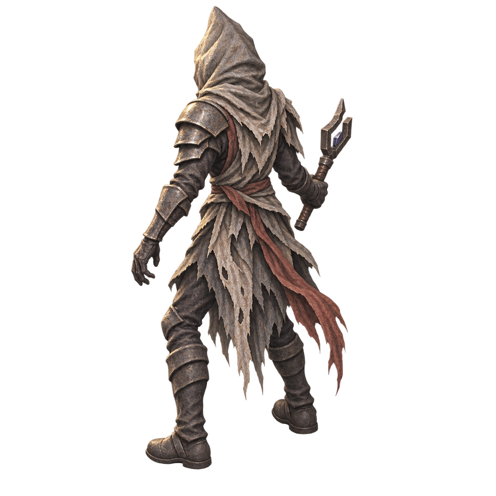

# Hollow Stray: complete candidate idle facings

**Candidate only. Art acceptance is false. No merge, live deployment, or default runtime change.** This extends the isolated #119 review fixture with NE, SE and NW idle images, filling the three directions that previously reverted to unrelated baseline enemy art. SW and its casting poses are byte-identical to #114/#119.

## Actual files and provenance

The three new 1254×1254 RGBA sources are in `../sources/storm_imp/hollow-idle-{ne,se,nw}-candidate.png`. Built-in image generation on 2026-11-10 used the actual SW source as an identity reference. No source pixels were repainted, masked, mirrored, resampled or cropped. `prompts.json` contains every exact prompt; `image-inspection.json` records source geometry and hashes. All new files are regular Git blobs under the existing narrowly scoped candidate `.gitattributes`.





## What is consistent, and what is not

Independent visual review found the intended front-right and two rear diagonals, anatomical right-hand forked casting rod, anatomical left pauldron/gauntlet, closed rear hood, muted red sash, ragged cloth and rusted armor consistent enough for opt-in review. No severe identity mismatch or mirror-swap was found.

This is **not** an approved canonical turnaround or animation. Cloth strips, sash drape, shoulder proportions and stance vary. Sparse red/yellow edge specks and body alpha mostly 252–253 remain, also present in the retained SW reference. Raw alpha includes near-transparent edge contamination; the alpha>=16 bounds are measurements only, never cleanup. Full-size image inspection cannot replace gameplay-scale graphical review.

New per-view scales match SW's 88.6108px visible height. Manually estimated foot pivots retain a visible baseline about 0.15px above tile origin. Horizontal pivots are approximations between the two boot contacts and require graphical review; measurements do not prove visually stable rotation. Open `review.html` locally to inspect the actual PNGs over light/dark backgrounds at gameplay scale and 4×. This HTML is a source inspection layout, **not an engine screenshot**.

## Behavior

Only `CandidateUnit.gd` reads these entries, after `stage.py` explicitly copies the project and opts that disposable copy in. The real default Unit scene and manifests stay unchanged. Logical N/E/S/W maps to NE/SE/SW/NW and camera rotation updates it without mirroring. SW alone supports windup/release; other facings correctly retain idle and generic effects. Cast release, cancel and rotation clear stale poses. Missing optional source rows retain the old defensive fallback.

No new enemy type, skill, walk, hurt, KO, non-SW cast or limb animation is supplied. Kael remains idle-only; Zane's existing candidate cast remains SE-only; Void Cultist is unchanged.

## Reproducible validation

From repository root, with Pillow installed:

```sh
python demos/isometric-2v2/tests/candidate_assets/hollow-directions/validate.py
python demos/isometric-2v2/tests/candidate_assets/stage.py /tmp/hollow-candidate-review
godot --headless --editor --path /tmp/hollow-candidate-review --import
godot --headless --path /tmp/hollow-candidate-review res://tests/candidate_assets/HollowDirectionTest.tscn
godot --headless --path /tmp/hollow-candidate-review res://tests/candidate_assets/CandidateTest.tscn
godot --headless --path /tmp/hollow-candidate-review res://tests/candidate_assets/FullMatchTest.tscn
```

Use isolated XDG data/config/cache directories as described in the parent README. The candidate CI now runs the new direction test and the existing six graphical posed captures, including all four directions. Those are diagnostic engine views, not a manual playthrough.

Local Godot 4.6.3 evidence:

- Source alpha/hash/geometry validation: 36 checks, zero failures.
- New direction test: 126 checks, zero failures. The initial test failed with 52 missing-facing assertions before the adapter change; its red log is retained. Review added unsupported release and camera-rotation cancellation coverage.
- Existing candidate contract: 113 checks, zero failures.
- Existing complete battle/replay: 99 checks, zero failures; actual observer saw the new NW texture during combat, two Fire casts, both enemies defeated and a fresh confirmed move after replay. Separate source geometry and direction tests cover NE/SE.
- Second import completed without script errors. First import reported unresolved audio loaders before importing the existing audio assets; rerunning import resolved them without source changes.

Local headless success is not graphical art acceptance, browser/mobile input, performance/audio measurement, or the complete repository-wide suite. The existing staged `CompactSkinTest` intentionally expects baseline compact art and is incompatible with candidate actors. Normal-project regression and exact-head CI results will be reported in the draft PR. Keep this draft pending actual graphical review and alpha/continuity cleanup.
