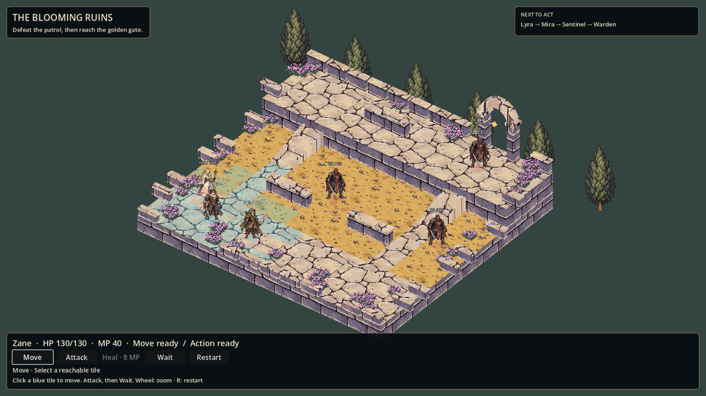

# The Blooming Ruins — playable painted 2.5D demo

An isolated Godot scene demonstrating painted textures on simple real 3D terrain,
Sprite3D characters/plants, selectable cells, two stair routes, and a small tactical
encounter. This is an engine prototype, not the generated concept image running
as a background. Campaign scenes and the default project entry point are unchanged.



See the [repository integration review](../../../docs/design/blooming-ruins-integration.md)
before extending this experiment. The production game already has a 3D terrain
presentation seam, canonical character loadouts and a complete battle lifecycle.

## Play

Open the repository's `godot/project.godot`, open
`res://demos/blooming_ruins/BloomingRuins.tscn`, and press F6.
On this Windows workstation, double-click `Play.cmd`. Set GODOT_EXE if installed
elsewhere. The launcher uses separate local save directories.

CLI from the repository root:

```
godot --path godot --rendering-method gl_compatibility res://demos/blooming_ruins/BloomingRuins.tscn
```

- Move: click a blue cell. Each activation allows one move of up to four cells.
- Attack: click an enemy in range. Hover for normal damage and hit/critical chance.
- Mira's Light costs 6 MP. Her Heal restores up to 45 HP, costs 8 MP, range 3.
- Zane fights at range 1; Lyra shoots at range 4. Walls block ranged sight.
- Move and act in either order, then Wait. Shared production CT selects the next unit.
- Defeat the three opponents, then move a surviving ally onto the golden gate tile.
- Mouse wheel zooms; 1/2/3 select Move/Attack/Heal, Space waits, R restarts.
- Buttons support keyboard focus. Tile targeting is mouse-based in this demo;
  complete gamepad navigation is not implemented.

## Architecture and scope

Encounter.gd owns demo state, occupancy, stair adjacency, seeded rolls and victory.
It calls the production CombatFormula and TurnOrder services. Stage.gd owns 3D
rendering, picking, UI and movement/hit feedback. CombatOutcome from PR #94 is not
required by this demo. It lives alongside production, not inside the campaign.

The demo deliberately omits counters, equipment, boons, status effects, saves,
loot, authored walk/attack animations, sound and campaign rewards. Stats and
encounter composition are prototype tuning, not a balance claim. Enemy AI pursues
the nearest living ally. Height transitions require the two authored stair lanes.
Decorative perimeter walls sit outside walkable centers; cover bonuses are absent.

The sprites are illustrated static cutouts with movement tweens and hit numbers.
The camera is fixed isometric, with zoom. Detailed silhouette variation, shadows,
environment storytelling and animation remain art-polish work. Do not represent
the generated stage concept as a screenshot of this implementation.

## Art provenance / generation

Built-in image generation produced two new atlas images based on user-supplied
ochre ground, cream/lavender stone, lilac flowers and Zane's approved turnaround.
Original reference files were not modified. Alpha cutout objects are mapped to
Sprite3D regions at runtime; stone/soil atlas quadrants are mapped onto meshes.

Terrain prompt: square atlas with exactly four equal quadrants, no borders/text;
top-left cream hand-painted flagstones, top-right ochre soil, bottom-left lavender
masonry elevation, bottom-right olive grass. Flat orthographic diffuse surfaces,
inked edges and painted chips matching supplied references, no perspective.

Sprite prompt: transparent 3-column by 2-row atlas. Top: Zane in navy/cream/brass,
cream-robed staff healer, olive-hooded ranger. Bottom: charcoal/burgundy soldier,
lilac flower clump, cypress tree. Full bodies, three-quarter view slightly from
above, hand-painted inked contours, no ground/background/text, isolated cells.

The exact prompts are also retained in the creation chat. Existing source art
and the resulting atlases should remain subject to the project's asset review.

## Validation

Run `res://demos/blooming_ruins/Test.tscn` for movement budget, occupied/blocked
cells, both stairs, objective connectivity, shared damage/healing, MP gates,
victory/defeat, actual scene controls, body picking and enemy-turn handoff.
29 checks passed with Godot 4.6.2; native OpenGL Compatibility render captured.
Repository static checks passed with 21 pre-existing warnings. Repository
release uses 4.6.3; rerun normal release checks before integration.
